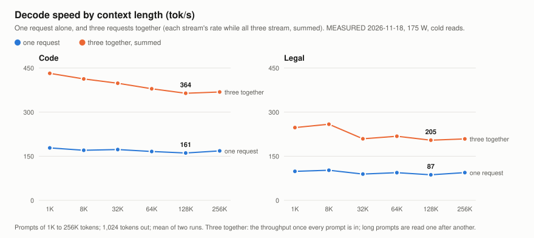
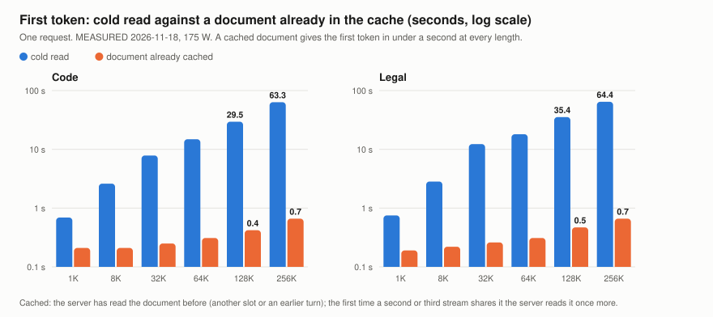

# Volta 12X AmPLIfy: DeepSeek-V4.1-Flash-1017 on twelve V100-SXM2 32 GB cards, every routed expert in NVFP4, three pipeline stages of four (PP3 x TP4)

Built by **Nick Mermiges, Esq.**, founder of [PLI Labs](https://proprietarylegal.ai/labs.html) · [proprietarylegal.ai](https://proprietarylegal.ai)

Weights: the routed experts are [nvidia/DeepSeek-V4.1-Flash-1017-NVFP4](https://huggingface.co/nvidia/DeepSeek-V4.1-Flash-1017-NVFP4)
(MIT), NVIDIA's NVFP4 pack of [deepseek-ai/DeepSeek-V4.1-Flash-1017](https://huggingface.co/deepseek-ai/DeepSeek-V4.1-Flash-1017)
(MIT), whose expert values equal the official MXFP4 experts (UPSTREAM: NVIDIA's model card; checked on sampled layers in
our earlier work). The non-expert tensors and the Engram table are the
[ISTA-DASLab GSQ-RCO GGUF](https://huggingface.co/ISTA-DASLab/DeepSeek-V4.1-Flash-1017-GSQ-RCO-GGUF) (MIT); the config,
the tokenizer and the DSpark drafter are DeepSeek's. This repository holds no weights, no expert packs and no compiled
libraries, and it downloads nothing.

This repository is the build's record as of its fourth release (2026-11-19, afternoon): the engine changes as install
kits in `kit/` (`PP3KIT9S-over-cut` serves), the judges and probes of the test windows in `tools/` with CPU tests in
`tests/`, the measurements in [docs/measurements.md](docs/measurements.md), the architecture, the history of every
window, the kernel and optimization plan and the time budget. The serving profile is described in [docs/OPERATIONS.md](docs/OPERATIONS.md) and [RUNNING.md](RUNNING.md); it is
not shipped as a file. The window driver, its chains, the bench tools and the launcher are not in this release: they name
the host's layout ([NOT-YET-PUBLISHED.md](NOT-YET-PUBLISHED.md)).

The engine is PLI Labs' copy of [1CatAI/1Cat-vLLM](https://github.com/1CatAI/1Cat-vLLM), the SM70 fork of vLLM, with
the DeepSeek-V4.1-Flash package of [#1277](https://github.com/1CatAI/1Cat-vLLM/pull/1277), as PLI Labs' eight-card builds
carry it at commit `f20d155`. Every change for twelve cards reaches that tree as a kit of whole engine files; the serving
kit is engine `9733024` plus the batched projection, 18 files. Each kit's `MANIFEST` pins the sha256 of every file it
replaces and of every new file, so a kit applies only to the bytes it was cut for and comes out byte for byte. The base
engine is not published as a tree; [engine/README.md](engine/README.md) lists every kit with its commit and state. The
three-stage layout is that of PLI Labs' 1Cat-vLLM pull request [#1031](https://github.com/1CatAI/1Cat-vLLM/pull/1031),
which ran this model on twelve cards at about 3 tok/s on an eager engine (UPSTREAM); the kit here is new code on the
fast engine, and no file of #1031 is copied.

Every figure on this page is labelled. **MEASURED** is a log or probe on our twelve-card host, with its test window
named (windows are short labels such as `s4`, `p6b` or `b4a`; dates and UTC times are in
[docs/measurements.md](docs/measurements.md)). **ARITHMETIC** is computed from measured or read values. **ESTIMATE** is a
model, with its basis. **UPSTREAM** is someone else's number, with its source. **PREDICTED** was written before a
window's data. A figure from one run says so.

What it does:

- Twelve V100-SXM2 32 GB cards as three pipeline stages of four tensor-parallel cards: layers 0-13, 14-27 and 28-39,
  each stage on one NVLink board, the two hand-offs over PCIe. The first stage holds the embedding and the Engram of
  layers 1 and 14; the last holds the drafter, the head, its own embedding and a mirror of KV source 20.
- All 15,360 routed experts in NVFP4 in card memory: 5,376 / 5,376 / 4,608 by stage, 0 in host memory, none compressed
  further, on every rank of every all-NVFP4 boot since window w3 (MEASURED).
- 524,288 tokens of context a request, four slots (four conversations kept warm on the cards), prompt chunks of 4,092
  rows.
- Cached prefixes: a request on a document the server has already read gets its first token in under a second at
  every length from 8K to 256K (MEASURED, below); a turn on a grown chat reads only what the turn added.
- DSpark speculative decoding with DeepSeek's drafter on the last stage.
- A card limit on every stage (31,998 MiB, a fuse at the owner's line for the highest sample on any card).
- vLLM's OpenAI-compatible API server, with a token cache that tokenizes only what a chat added.
- A serving form that never serves while it checks: the full checks run on a test port and write a record; the serving
  boot sends no request and refuses bytes the record does not name.

The eleven adopted lines (the serving record carries their digest; the serving boot refuses a set the record does not
know):

| Line | What it does | Window |
|---|---|---|
| `VLLM_V41_EMPTY_CACHE_TOKENS=8192` | the engine releases its cached card memory only at prompt steps above 8,192 rows, not at every step of 2,048 or more | p1, serving since p2s |
| `VLLM_V41_PP_MID_PREFILL_SKIP=1` | the middle stage stops computing its late layers on prompt chunks the skip rule allows | p2 |
| `VLLM_V41_PP_EMPTY_AHEAD=1` | a request's spacing steps are submitted while its step is in flight | p3c |
| `VLLM_V41_PP_ANSWER_NO_SLEEP=1` | no sleep between an answer and the next submission | p3c |
| `VLLM_V41_DRAFT_GEMV2=1` | the drafter's faster GEMV | p3c |
| `VLLM_V41_MULTI_SEQ_PROMPT_END_HOLD=128` | holds the decode steps that follow a prompt's end, so a short turn is not queued behind another chat's long read | p5 |
| `VLLM_V41_PREFIX_TOKEN_CACHE=1` | the API server keeps the last eight prompts' text and ids and tokenizes only what a chat added | p4b |
| `VLLM_V41_PP_TURN_CHUNKS=3` | a turn's last rows read as a head and three 1,024-row chunks, so the stages overlap | p5, p5u |
| `VLLM_V41_INDEX_TC=1` | the sparse-attention index scorer on the tensor cores | p6b |
| `VLLM_V41_WO_A_BATCHED_4K=1` | the attention output projection of a 4,092-row prompt chunk in one batched launch | c2a |
| `TM_GEMM_TUNE=max_splits=1` | the TurboMind multiply library's own switch: one split of the inner dimension at every row count | b4a |

## Fourth release (2026-11-19, afternoon, commit `03f71bc`): what changed

Measured by window b4a (12:30:04Z to 13:13:21Z) on two boots of one kind at the serving cap: `Wr` = kit 9S with the ten lines of the third release, `Wc` = the same with `TM_GEMM_TUNE=max_splits=1`.
Window b3a (13:45:04Z to 14:08:19Z) then tried the exact four-card sum. The bench and the prefix-sharing measure ran on
the serving port without a restart, 14:09:20Z to 16:24:31Z, against the same two measures of the morning on the ten
lines (05:53Z to 08:08Z). Every cell is copied from [docs/measurements.md](docs/measurements.md) (windows b4a and b3a,
the summaries, the bench sections) and [CHANGELOG.md](CHANGELOG.md).

| | Third release (ten lines) | Fourth release (eleven lines) | Change | Measured in |
|---|---|---|---|---|
| Kit and lines | `PP3KIT9S-over-cut`, ten lines | the same kit, eleven lines: `TM_GEMM_TUNE=max_splits=1` added | | b4a |
| Kit published, not serving | | `PP3KIT9V-over-cut`, `VLLM_V41_TP_EXACT_SUM` default off | | b3a |
| Accepted capture of the seven long prompts | `quality-TC3-WOA4K.json` | `quality-TC3-WOA4K-S1.json` | | b4a |
| Cold reads of 60,706 / 93,028 / 247,953 / 425,783 tokens, the only request | 4,664 / 4,747 / 4,515 / 4,327 tok/s | 4,659 / 4,756 / 4,552 / 4,314 tok/s | -0.1 / +0.2 / +0.8 / -0.3 % (line: within 3 % either way) | b4a, `Wr` against `Wc` |
| First token of those reads | 13.02 / 19.60 / 54.92 / 98.41 s | 13.03 / 19.56 / 54.47 / 98.70 s | | b4a |
| One request, fresh text, four slots | 135.6 tok/s | 137.3 tok/s | +1.3 % | b4a |
| One request repeated; four together, sum | | | +4.7 % and +4.3 %: the generated text moved; report only, no gain claimed | b4a |
| Closeness to the ten-line capture | identical 7 of 7 | identical 1 of 7; CLEAN; median first divergence 45 / 48 tokens; median mean \|dlogprob\| 0.0366 / 0.0350 nats | HOLDS (line: at least 25, at most 0.0614) | b4a |
| Highest card sample, four-chat rehearsal (30 requests, largest prompt about 153,600 tokens) | 30,832 MiB | 30,832 MiB | | b4a |
| Bench, one stream at 128K, decode, code / legal / prose | 175.0 / 94.2 / 79.9 tok/s | 157.4 / 93.1 / 85.6 tok/s | the text moved in every cell: -10.1 to +9.0 % by cell, mean -0.9 %; not a before-and-after | morning bench; bench 14:09Z |
| Bench, one cold read at 128K, prefill, code / legal / prose | 4,657 / 3,944 / 4,331 tok/s (legal and prose: means of a slow first and a fast second repeat) | 4,670 / 4,538 / 4,586 tok/s | within -0.7 to +0.7 % of the morning's second repeats at every length | morning bench; bench 14:09Z |
| First cold read of a 128K legal document, first token | 39.5 s | 28.9 s | the slow first read did not recur | morning bench; bench 14:09Z |
| First token at 256K, code / legal / prose | 60.23 / 64.46 / 61.89 s | 58.03 / 59.28 / 58.83 s | | morning bench; bench 14:09Z |
| Three streams released together at 128K, sum of decode rates | 391.5 / 216.1 / 192.3 tok/s | 360.0 / 212.6 / 198.3 tok/s | the text moved | morning bench; bench 14:09Z |
| First token on a cache hit at 128K | 0.42 to 0.43 s | 0.43 to 0.44 s | | morning measure; measure 15:40Z |
| Three streams on one cached 128K document, the all-hit repeat, over the window | 399.8 / 242.2 / 221.5 tok/s | 426.6 / 230.1 / 221.0 tok/s | the text moved | morning measure; measure 15:40Z |
| Highest card sample, bench and measure (2 h 15 min) | 30,418 MiB (1,522 samples) | 30,418 MiB (1,513 samples) | | both runs |

The split count fixes the dense library's split of the inner dimension at one, so a prompt's last chunk no longer rounds
by its row count. Its first arm (g1 and t1, 2026-11-17) had ended INCONCLUSIVE against the all-native reference; b4a
judged it against the build's own capture by the closeness rule every rounding change since has met. It moves rounding,
so the text of every bench cell changed (0 of 54 token digests shared) and each decode cell moved with its text. The slow
first cold read of the two benches before did not recur. HYPOTHESIS, from the one line that differs: the library's split
search on a shape it had not yet seen, which the fixed split count removes; not established by a boot built to test it.

Window b3a tried the exact four-card sum (kit 9V, `VLLM_V41_TP_EXACT_SUM=1`: each rank's part sent to every rank and
summed in one fixed order in FP32, in 8 MiB tiles, rounded once). The reference boot with the switch unset was
identical 7 of 7 to the eleven-line capture, so kit 9V unset is the serving arithmetic. The candidate's witness found
12 of 12 ranks on the exact path; its answers were CLEAN but identical 0 of 7, median first divergence 13 tokens where
25 were asked (median mean \|dlogprob\| 0.0348): FAILED. On the board, with no model, the exact sum costs 2.632 ms
against 1.180 ms for the library's sum on a large call, 2.2 times, the four ranks bit for bit equal (MEASURED). The
rule had named the speed line as the one that fails; closeness failed first, so the read cost in percent was not
measured: the prediction was wrong on the deciding line. The kit is published with its switch off.

In b4a the hits-closeness measure rejected most of its own receipts: it demanded a probability mass at or under
1 + 1e-7 over twenty float32 logprobs, and the measured masses were 1.000000134 and 1.000000119. The bound was corrected
to a float32 tolerance before b3a, where it read all nine cells (Long context, below).

No outside code is new in this release. The split count is a switch of OpenMMLab's TurboMind multiply library, carried
in the engine's tree under lmdeploy's sources; the build found on the cards that its dispatch picks the split from the
row count, and `tools/tm_dispatch_emulation.py` re-implements that cost model to predict it. Kit 9V is ours.

## Third release (2026-11-19, morning, commit `6985aa1`): what changed

Measured by window c2a (03:19:25Z to 03:55:51Z) on two boots of kit 9S at the serving cap: `Wr` with
`VLLM_V41_WO_A_BATCHED_4K` off (the nine lines of the second release), `Wc` with it on. Windows st5 to st7, c3a, c3b and
c7a tried the other levers of the plan's list and failed their lines. The bench and the prefix-sharing measure ran again
on the serving boot of c7a without a restart, 05:53:12Z to 08:08:28Z, against the closing bench of 2026-11-18 on the nine
lines (21:01Z to 22:36Z) and its measure (22:38Z to 23:22Z). The 2026-11-18 tables are in
[docs/measurements-2026-11-18.md](docs/measurements-2026-11-18.md), the morning's in
[docs/measurements-2026-11-19-morning.md](docs/measurements-2026-11-19-morning.md).

| | Second release (kit 9N, nine lines) | Third release (kit 9S, ten lines) | Change | Measured in |
|---|---|---|---|---|
| Kit | `PP3KIT9N-over-cut`, 17 files | `PP3KIT9S-over-cut`: kit 9N's 17 files plus `prefill_dense_blas.py` (new); `dense_tm.py` and `model.py` changed | | c2a |
| Kits published, not serving | | 9Q, 9T (the lean hand-off), 9R, 9U (the packed experts), default-off switches | | c3b, c7a |
| Cold reads of 60,705 / 93,025 / 247,948 / 425,779 tokens | 4,476 / 4,559 / 4,358 / 4,028 tok/s | 4,663 / 4,741 / 4,531 / 4,309 tok/s | +4.2 / +4.0 / +4.0 / +7.0 % (line: each at least 97 %, the 93K cell at least 102 %) | c2a, `Wr` against `Wc` |
| First token of those reads | 13.56 / 20.41 / 56.90 / 105.70 s | 13.02 / 19.62 / 54.72 / 98.81 s | | c2a |
| Closeness to kit 9N's capture (the change moves rounding) | | identical 1 of 7, none diverging at tokens 0 to 3; median first divergence 58; median mean \|dlogprob\| 0.0354 nats | HOLDS (line: at least 25, at most 0.0614) | c2a |
| Highest card sample, four-chat rehearsal | 30,816 MiB | 30,832 MiB; 0 out-of-memory lines | ceiling 31,800: PASS | c2a |
| Decode round at about 128K, one request: after a one-step turn / after a cold read | 25.8 / 25.7 ms | 25.895 / 25.588 ms | the round did not move | p6b; c7a's reference boot |
| Decode round on a short chat | 24.4 ms | 24.388 / 24.284 ms | | p6b; c7a |
| Bench, one stream at 128K, decode, code / legal / prose | 161.1 / 86.9 / 87.3 tok/s | 175.0 / 94.2 / 79.9 tok/s | the text moved in every cell of 8K and longer: -8.5 to +8.6 % by cell, mean +0.9 %; not a before-and-after | bench of 2026-11-18; morning bench |
| Bench, one cold read at 128K, prefill, code / legal / prose | 4,444 / 3,794 / 4,033 tok/s | 4,657 / 3,944 / 4,331 tok/s | cold code reads +4.8 to +5.0 % at 32K and longer; legal and prose second repeats +3.5 to +4.3 % | same |
| First token at 256K | 63 to 64 s on every kind | 60.23 / 64.46 / 61.89 s (second repeats of legal and prose: 59.23 and 58.79 s) | | same |
| Three streams released together at 128K, sum of decode rates | 364.2 / 204.6 / 200.3 tok/s | 391.5 / 216.1 / 192.3 tok/s | | same |
| First token on a cache hit at 128K, one stream | 0.42 / 0.47 / 0.40 s | 0.42 to 0.43 s | | the two measures |

The batched projection was PREDICTED at about 2.7 % off a chunk from the code read; the measure was 4.0 to 7.0 %,
largest at the longest read: wrong, low. Another rounding of the same arithmetic, so the accepted capture became
`quality-TC3-WOA4K.json`. Three corrections of record came with the bench: the column Total decode tok/s runs from the
earliest first token to the last request's end (numbers unchanged, words corrected); a one-stream decode figure is the
figure of the text generated in its cell; and in both benches of that time the first cold read of a legal or prose
document was 1 to 11 s slower than its second repeat (code not), so those cells were means of a slow and a fast
repeat.

What failed in this release, each on a line written before its data:

- **The conversation store** (windows st5 to st7, kit over 9N). Every state check passed (the dump, a restart on the
  saved set, exact answers after the restart, memory equal to the store-off boot, 0 waits on the save path). The
  timing line failed: the first token of the larger turns in the four-chat rehearsal was 4.718 and 3.722 s with the
  store on against 3.596 and 3.590 s off, limit 3.696; the small turns straddled their limit (INCONCLUSIVE). The overlay
  was rolled back; the store stays off and its kit stays private.
- **The lean pipeline hand-off** (item C3). Kit 9P did not boot in window c3a: it assumed a hidden size of 4,096 where
  the model's is 5,120, and its CPU test had taken the number from inside the test. Kit 9T (geometry read from the
  model) ran in c3b: the round at 128K after a cold read 0.133 ms shorter where 0.3 was asked, FAILED; the turn cell
  unreadable against two boots whose spreads overlapped. PREDICTED 0.15 to 0.45 ms: met at its low end, the line not.
- **The packed expert records** (item C7, kit 9U, window c7a). Expert packs re-cut without their zero padding answered
  identical 7 of 7 and used 756 / 878 / 878 MiB less a card by stage, but the rounds were longer: +0.095 and +0.155 ms
  at 128K, +0.27 and +0.90 % on short chats. PREDICTED 0.33 to 0.41 ms shorter: wrong in sign.
- **Two kernel items closed at their timing gate without a window.** The native expert layer in one launch (C4) saves
  at best 0.205 ms a round, sized on a CPU against the engine's own fused kernels, under the 0.300 ms gate. The gaps
  between prompt chunks (C1) measure under 0.37 % of a chunk, under the 2 % gate.

No outside code is new in this release. Kits 9S, 9Q, 9T, 9R and 9U are ours; the small library of the packed experts
(`kit/PP3KIT9U-over-cut/lib/v41qpn576/`) builds from pinned engine sources.

## Second release (2026-11-18, evening, commit `ae906d6`): what changed

Measured by the windows p2s to q1 of 2026-11-18, each a reference boot against a candidate with one change, its rule
written before its data, and by the closing bench on the serving set (21:01Z to 22:36Z) with the prefix-sharing measure
(22:38Z to 23:22Z). The first release served kit 6c with no adopted line; the second serves kit 9N with nine lines at the
serving cap named under Results. The cap was higher before the host tripped (below): windows p1, p2, p3b and p3c and the
runs after g1 ran at that higher cap, so a row setting them beside the second release crosses caps, and a row compares
only figures of one window where it can.

| | Before: the first release, or the window's reference boot | After: the second release | Change | Measured in |
|---|---|---|---|---|
| Kit and lines | `PP3KIT6c-over-cut`, no lines (the first release) | `PP3KIT9N-over-cut`; the nine lines of the table above, all but the batched projection and the split count | | p2s to p6b |
| Cold reads of 60,704 / 93,027 / 247,952 / 425,776 tokens, the release setting and the middle-stage skip | 3,810 / 3,696 / 3,284 / 2,757 tok/s (kit 8, `off`) | 4,562 / 4,515 / 4,405 / 4,223 tok/s (`adopt`) | +19.7 / +22.1 / +34.1 / +53.2 % (line: +5 % at 93K) | p2 |
| One cold read of about 425,780 tokens, the only request on the serving port | 173.49 s, 2,454 tok/s (kit 8 `off`) | 102.73 s, 4,145 tok/s | | p1; p5u |
| Decode round at about 128K, after a one-step turn / after a cold read | 28.2 / 26.3 ms (p3b's reference boot, kit 9M with the loop switches off) | 25.8 / 25.7 ms | | p3b; p6b |
| Decode round on a short chat | 25.5 ms (the same boot) | 24.4 ms | | p3b; p6b |
| Four requests together, fresh text, sum | 312.1 tok/s (kit 6c, one run) | 337.9 tok/s | +6.7 % against the same window's reference boot without the scorer (316.6) | after g1; p6b |
| First token of a turn alone on a 128,000-token chat, +880 / +2,048 / +4,200 / +10,000 new tokens (medians of two) | 1.184 / 2.061 / 3.687 / 4.963 s (`off`, the serving lines without the two switches) | 1.131 / 1.471 / 2.319 / 3.623 s (turn chunks) | +4,200: 63 % of `off` (line: at most 75 %) | p5 |
| A turn of 880 tokens beside another chat's 248,000-token read, the whole turn (medians of three) | 11.99 s | 5.12 s; the read's first token 60.99 s against 62.66 | -57 % (line: -50 %) | p5 |
| The front of a turn on a 128,000-token chat (template, tokenizing, hashing), median of 20 turns | 308.0 ms | 47.2 ms | 0 of 20 turns not faster (line: 150 ms) | p4b |
| Highest card sample, four-chat rehearsal | 30,398 MiB (s4) | 30,814 MiB (ceiling 31,800) | | s4; p5u, p6b |
| Closing bench, one stream at 128K, decode / prefill, code / legal / prose | | 161.1 / 86.9 / 87.3 tok/s; 4,444 / 3,794 / 4,033 tok/s | first bench of the build | bench of 2026-11-18 |

What the windows found beyond the table. The middle-stage skip was PREDICTED at +3 to +8 % and gave +10.4 % at 61K to
+49.6 % at 426K alone: wrong, low, the gain growing with length. In p3c the engine core's own counters showed
2.83 ms from an answer to the next submission after a one-step turn; with the spacing step submitted ahead the round
shortened by 1.157 ms on a short chat and 1.179 ms at 128K (-4.55 / -4.19 %), PREDICTED 1.14 to 1.27 ms, met. The turn
chunks are another rounding of the same arithmetic, so the accepted capture became `quality-TC3.json`. The tensor-core
scorer, designed from one captured decode step's index operands (p3l), shortened the round at 128K by 0.80 to 0.96 ms
where "about 1.2" was PREDICTED. Window q1 booted twice without the drafter: eight forced cells, text equal 8 of 8.

The release also fixed the first release's kits: the repository's ignore rule for `models/` (meant for weights) had
swallowed every kit's `files/models/deepseek_v41/` tree, so kits 6c, 7 and 8 as first published could not apply. The
second release restored them.

Contributors: an independent review of 2026-11-17 found that the token cache returned wrong ids after an edit at its
cut (held, repaired, proven by two fuzzes, one of 3,200 edits with 0 sequences different from a full encode, then by
three edits on the cards) and that the equality judges accepted cut answers (made strict); an independent reviewer read
window p6's real logs and found its judge's units wrong (scorer counter steps against engine-core "answers", which count
prompt chunks too). The corrected judge compares the counters with the drafter's own verification count (6,641 = 6,641
on twelve workers in p6b) and carries tests computed by hand from the real lines. All code of this release is ours.

## First release (2026-11-18, commit `2e291f3`): what it held

The build's record after window p1: kit 6c serving at four slots under the card limit, the measurements of windows w1 to
p1, the architecture, the history, the kernel and optimization plan, the time budget and three reviews. Kit 6c is 11
files over `f20d155`: three pipeline stages, the scheduler's spacing rule for a pipeline of three, up to eight slots, the
middle stage's memory changes and the optional card limit. Windows s4 and o2 ran at a lower power cap than the serving
one, p1, t1 and the runs after g1 at a higher one.

| What | Figure | Window |
|---|---|---|
| One request, fresh / repeated text, four slots | 128.1 / 176.6 tok/s (s4); 129.7 / 179.2 (after g1, one run) | s4; after g1 |
| Four requests together, fresh / repeated, sum | 306.6 / 453.4 tok/s (s4; 60.5 to 85.5 and 110.9 to 117.8 each); 312.1 / 447.5 (after g1, one run) | s4; after g1 |
| Three requests together, fresh / repeated, sum | 288.0 / 444.6 tok/s | o2 |
| Prompt read, one 62,263-token prompt | 3,284 tok/s (s4); 3,733 (after g1, +13.7 %, one run) | s4; after g1 |
| Cold reads of 60,706 / 93,025 / 247,953 / 425,777 tokens, one run | 3,850 / 3,833 / 3,316 / 2,454 tok/s | p1 |
| One-request decode round, one run | 25.1 ms | t1 |
| The release setting | reads +12.6 % at 61K and +9.9 % at 93K, identical answers, no higher memory peak | p1 |
| Load, launch to ready | 134 s | s4 |
| Highest card sample, four grown chats at once | 30,398 MiB (29,838 / 30,398 / 28,892 by stage); 0 out-of-memory lines | s4 |

How it got there. The first three-stage boot answered wrongly (w1: 15 of 15 answers differed): nothing spaced a
request's decode steps by the pipeline depth, so the first decode round after every prompt was computed on another
request's tokens. The cause was found by running the real engine loop on a CPU and fixed by the spacing rule in kit 3
(w3: CLEAN, 0 of 12 early divergences against a two-stage reference boot of the same experts). Kits 5c and 6c took the
embedding off the middle stage and applied layer 14's Engram on the first stage: the two-slot peak fell from 31,808 to
31,336 MiB (w3, w5). 4,092-row chunks halved a prompt read's working memory on the middle stage, which made room for a
third slot (o2) and a fourth (s4, about 345 MiB on the fullest card, no token changed). The card limit changed no token
and no memory mark (k1). The cause of a second rounding was found by reading and proven on one card in 25 seconds: the
dense library picks its split count from a chunk's row count, at all sixteen row counts a CPU model had predicted.

Contributors: the layout and its exactness evidence are from 1Cat-vLLM #1031 (PP3 against PP2 bitwise identical over
2,744 tensors, UPSTREAM); the engine descends from yangzhuxinyzx's
[#1277](https://github.com/1CatAI/1Cat-vLLM/pull/1277) through PLI Labs' two-board port; every routed expert runs on
Peuqui's `sm70_skinny` QPN backend ([#742](https://github.com/1CatAI/1Cat-vLLM/pull/742)) with Dennis Vertzyas'
[v100-skinny](https://github.com/dnv2003/v100-skinny) kernels; Peuqui's [#1362](https://github.com/1CatAI/1Cat-vLLM/pull/1362)
is the precedent for taking the embedding off the middle stage (our change is new code). Every source is in
[CREDITS.md](CREDITS.md).

## Results

All numbers are ours, MEASURED with our own clients on the twelve-card host, on the serving set since window b4a: kit
`PP3KIT9S-over-cut`, the eleven adopted lines, four slots, 175 W per card and the 1,452 MHz clock ceiling (cards at 1,447 MHz), unless a row
names another window. Greedy decoding, thinking off, 1,024 tokens out, unless a row says otherwise. The bench and the
prefix-sharing measure ran on the serving port without a restart (14:09:20Z to 16:24:31Z on 2026-11-19), their users
holding their traffic; the earlier releases' rows are in their sections above, and the earlier benches stay in
[docs/measurements-2026-11-18.md](docs/measurements-2026-11-18.md) and
[docs/measurements-2026-11-19-morning.md](docs/measurements-2026-11-19-morning.md). The bench tools are not in this
release; their arithmetic is in [docs/measurements.md](docs/measurements.md).

### Quality: community benchmarks (2026-11-20 to 2026-11-22)

The sets the 1Cat-vLLM README cites, run on the serving port as ordinary traffic (kit `PP3KIT9X-over-cut`, the serving
set after this release; thinking on, temperature 0), each scored by its own tool against its own answers. MEASURED;
conditions, commands, per-task figures and the comparison's sources in [docs/benchmarks.md](docs/benchmarks.md).

| Set | Ours | Original 1017 weights (UPSTREAM, self-reported by others) |
|---|---|---|
| HumanEval / HumanEval+ (164) | 98.2 / 92.7 | HumanEval 95.73 |
| MBPP / MBPP+ (378) | 97.4 / 82.5 | none found |
| MATH-500 (500) | 97.0 | none found |
| GSM8K (1,319) | 94.7 | 96.97; 93.5 |
| MMLU (20 per subject, 1,140) | 92.5 | 88.22 (all 14,042) |
| MMLU-Pro (100 per category, 1,400) | 86.4 | 85.7 (300-question sample, reasoning on) |
| LegalBench (lm-eval's 5 tasks, 250) | 72.0 | 83.28 (vals.ai, all 162 tasks, API) |
| LongBench-E (9 tasks, 450) | 68.8 | none found |
| WikiText-2 perplexity (8 x 2,048 tokens) | 2.394 | none found |

The settings behind the comparison column differ from ours (samples, thinking, task sets); it shows the compressed
build kept the model, not a ranking. A speed measure after the last set found the server about seven times slower
than the 2026-11-19 figures below; the cause, the prompt store's full conversation tier, was fixed the same day and
the speed re-measured: one request 135.4 / 135.5 tok/s fresh and 185.8 / 186.2 repeated at 175 W, four together 324
summed ([docs/benchmarks.md](docs/benchmarks.md#speed)).

### Speed

The bench: code, legal and prose prompts of 1,024 / 8,192 / 32,768 / 65,536 / 131,072 / 262,144 tokens (a source file, a
brief, prose), read cold, one, two and three streams released together, two repeats each: 108 groups, 216 measured
requests; judge PASS completeness, the token digest of every lone repeat matched its pair 198 of 198. The measure: for
each length and kind one cold warm read put the document in the prefix cache, then one, two and three streams on that
document, two repeats; a hit is a first token under a quarter of the warm read's. Each cell is the mean of the two
repeats. "Prefill" is the prompt's tokens over the time to its first token. **Sum of decode rates** adds each stream's own
decode rate while all three stream: the throughput once every prompt is in. **Total decode** is all streams' output
tokens over the window from the earliest first token to the last request's end. The two-stream rows, the minimum and
maximum of every cell and each stream's own figures are in the linked tables.

**Code**

| Prompt | Decode, one stream (tok/s) | Prefill, cold (tok/s) | First token, cold (s) | First token on a hit (s) | Three streams, sum of decode rates (tok/s) | Three streams, total decode (tok/s) | Measured in |
|---|---:|---:|---:|---:|---:|---:|---|
| 1K | 183.8 | 1,567 | 0.65 | 0.21* | 443.4 | 425.2 | [bench](docs/measurements.md#code); [hits](docs/measurements.md#code-with-prefix-sharing) |
| 8K | 175.5 | 3,267 | 2.51 | 0.22 | 421.0 | 180.4 | [bench](docs/measurements.md#code); [hits](docs/measurements.md#code-with-prefix-sharing) |
| 32K | 175.8 | 4,478 | 7.32 | 0.26 | 404.2 | 151.0 | [bench](docs/measurements.md#code); [hits](docs/measurements.md#code-with-prefix-sharing) |
| 64K | 157.4 | 4,697 | 13.95 | 0.31 | 363.5 | 142.9 | [bench](docs/measurements.md#code); [hits](docs/measurements.md#code-with-prefix-sharing) |
| 128K | 157.4 | 4,670 | 28.07 | 0.43 | 360.0 | 138.0 | [bench](docs/measurements.md#code); [hits](docs/measurements.md#code-with-prefix-sharing) |
| 256K | 153.4 | 4,518 | 58.03 | 0.64 | 344.4 | 129.8 | [bench](docs/measurements.md#code); [hits](docs/measurements.md#code-with-prefix-sharing) |

**Legal**

| Prompt | Decode, one stream (tok/s) | Prefill, cold (tok/s) | First token, cold (s) | First token on a hit (s) | Three streams, sum of decode rates (tok/s) | Three streams, total decode (tok/s) | Measured in |
|---|---:|---:|---:|---:|---:|---:|---|
| 1K | 101.5 | 1,526 | 0.67 | 0.21* | 249.2 | 240.3 | [bench](docs/measurements.md#legal); [hits](docs/measurements.md#legal-with-prefix-sharing) |
| 8K | 92.9 | 3,253 | 2.52 | 0.22 | 218.9 | 131.8 | [bench](docs/measurements.md#legal); [hits](docs/measurements.md#legal-with-prefix-sharing) |
| 32K | 92.5 | 4,354 | 7.53 | 0.27 | 213.3 | 115.0 | [bench](docs/measurements.md#legal); [hits](docs/measurements.md#legal-with-prefix-sharing) |
| 64K | 93.4 | 4,561 | 14.37 | 0.33 | 214.7 | 113.9 | [bench](docs/measurements.md#legal); [hits](docs/measurements.md#legal-with-prefix-sharing) |
| 128K | 93.1 | 4,538 | 28.88 | 0.44 | 212.6 | 110.8 | [bench](docs/measurements.md#legal); [hits](docs/measurements.md#legal-with-prefix-sharing) |
| 256K | 92.4 | 4,422 | 59.28 | 0.70 | 207.0 | 106.0 | [bench](docs/measurements.md#legal); [hits](docs/measurements.md#legal-with-prefix-sharing) |

**Prose**

| Prompt | Decode, one stream (tok/s) | Prefill, cold (tok/s) | First token, cold (s) | First token on a hit (s) | Three streams, sum of decode rates (tok/s) | Three streams, total decode (tok/s) | Measured in |
|---|---:|---:|---:|---:|---:|---:|---|
| 1K | 86.1 | 1,603 | 0.64 | 0.20* | 213.9 | 209.6 | [bench](docs/measurements.md#prose); [hits](docs/measurements.md#prose-with-prefix-sharing) |
| 8K | 89.6 | 3,296 | 2.49 | 0.21 | 213.0 | 129.9 | [bench](docs/measurements.md#prose); [hits](docs/measurements.md#prose-with-prefix-sharing) |
| 32K | 94.7 | 4,432 | 7.39 | 0.27 | 219.9 | 116.9 | [bench](docs/measurements.md#prose); [hits](docs/measurements.md#prose-with-prefix-sharing) |
| 64K | 83.3 | 4,610 | 14.22 | 0.34 | 194.0 | 108.1 | [bench](docs/measurements.md#prose); [hits](docs/measurements.md#prose-with-prefix-sharing) |
| 128K | 85.6 | 4,586 | 28.58 | 0.44 | 198.3 | 106.9 | [bench](docs/measurements.md#prose); [hits](docs/measurements.md#prose-with-prefix-sharing) |
| 256K | 84.5 | 4,456 | 58.83 | 0.69 | 191.6 | 101.7 | [bench](docs/measurements.md#prose); [hits](docs/measurements.md#prose-with-prefix-sharing) |

\* At 1K the request's fixed cost is most of the read, so the cache cannot show: the 1K requests are not hits by the
measure's rule.

<picture>
  <source media="(prefers-color-scheme: dark)" srcset="docs/img/decode-by-context-dark.svg">
  
</picture>

<picture>
  <source media="(prefers-color-scheme: dark)" srcset="docs/img/first-token-dark.svg">
  
</picture>

The charts are drawn from the tables of [docs/measurements.md](docs/measurements.md) by
[docs/img/make_charts.py](docs/img/make_charts.py).

How to read these figures:

- **A one-stream decode figure is the figure of the text the bench generated in that cell.** Across texts of one kind a
  cell spreads about ±9 %; two repeats of one text agree within 2 %. The two benches of 2026-11-19 generated different
  text in every cell (the split count is another rounding) and their decode cells differ by -10.1 to +9.0 %, while the
  decode round did not move. So the band is the figure, not the decimal.
- **The pipeline carries one request per step, so long prompts are read one after another.** Three cold 128K code
  requests released together got their first tokens after 77.4, 90.5 and 90.5 s (28.07 s alone); their reads
  interleaved, a read that shares the cards with a decoding stream ran at roughly half its lone rate, and the three then
  decoded together. That is why Total decode stays near one stream's rate at 8K and longer while Sum of decode rates is
  2.2 to 2.5 times it.
- **With the document already cached the wait disappears.** Three streams on one cached 128K document, the all-hit
  repeat: code 432.7 tok/s summed and 426.6 over the window, legal 232.0 and 230.1, prose 222.5 and 221.0. The first
  time a second or a third stream shares a document the server reads it once more; after that every stream hits.

Fixed cells, one boot each, the serving arithmetic (four slots):

| Row | Result | Measured in |
|---|---|---|
| One request, fresh text | 137.3 tok/s | b4a, `Wc` |
| One request, fresh / repeated text; four together, sum | 137.6 / 188.5 tok/s; 328.5 tok/s | b3a, `Wr` (kit 9V unset, identical 7 of 7 to the serving capture) |
| Decode round at about 128K, one request, after a one-step turn of 880 on a 128,585-token chat / after a cold read of 127,663 tokens (medians of the loop's steady lines) | 25.895 / 25.588 ms on the ten lines; the split count did not move the round | c7a's reference boot; b4a |
| Decode round on a short chat, after a one-step turn / after a read | 24.388 / 24.284 ms on the ten lines | c7a |
| Cold reads of 60,706 / 93,028 / 247,953 / 425,783 tokens, the only request | 4,659 / 4,756 / 4,552 / 4,314 tok/s; first token 13.03 / 19.56 / 54.47 / 98.70 s | b4a, `Wc` |
| Load, launch to ready | 164 to 197 s | st7, c3a |

Where the time goes, from the engine's own timers and the torch profiler (window t1, kit 6c, one run;
[research/TWELVE-CARD-TIME-BUDGET.md](research/TWELVE-CARD-TIME-BUDGET.md)): one 4,092-row prompt chunk's median forward
span is 793 / 891 / 844 ms by stage, of which experts with the shared layer, router and their sums are 318 / 334 / 271
ms, attention 119 / 130 / 112 ms and the index 53 / 142 / 222 ms (it grows with context). A one-request decode round was
26.25 ms in the traces: experts 29 %, dense multiplies 21 %, the drafter 10 %, 14 % outside any kernel; it grew to 28.1
ms at 128,000 tokens and 31.0 ms at 249,000, the growth being the index.

### Long context and cached prompts

| Check | Result | Measured in |
|---|---|---|
| Context | 524,288 tokens a request, four slots | the profile |
| One cold read of 425,783 tokens, the only request | first token 98.70 s, 4,314 tok/s | b4a |
| Four documents of 110,000 to 140,000 tokens read at once | first token after 129 to 166 s each | s4 (kit 6c) |
| A turn alone on a 128,000-token chat, with the turn chunks, first token (medians of two) | +880 new tokens 1.131 s; +2,048 1.471 s; +4,200 2.319 s; +10,000 3.623 s | p5 |
| A turn of 880 tokens beside another chat's 248,000-token read, with the hold (medians of three) | first token 3.26 s, whole turn 5.12 s; the read's first token 60.99 s | p5 |
| The front of a turn on a 128,000-token chat (template, tokenizing, hashing), with the token cache | 47.2 ms (median of 20 turns) | p4b |
| Prefix hits in the measure | 150 of 216: the 36 requests at 1K are not hits by the rule, and 30 requests re-read the document, one per new slot the first time a second or a third stream shared it, never after | measure 15:40Z |
| First token on a hit | 0.43 to 0.44 s at 128K; 0.63 to 0.73 s at 256K | measure 15:40Z |
| A hit's tokens against its warm read | 0 of 150 hits reproduced the warm read's token digest; all 30 re-reads did | measure 15:40Z |
| A hit against its own cold read, nine bench prompts at 32K to 128K, greedy, 32 tokens | identical 4 of 9 (prose 3 of 3, code at 64K); median first divergence 25, median mean \|dlogprob\| 0.0275; every resend a hit by timing (0.25 to 0.45 s against 7.2 to 28.6 s cold) | b3a, `Wr` |
| Cached-token count in the server's usage | sent for 0 of 216 requests: a hit is known by timing only | measure 15:40Z |
| A warm request whose first 113,392 tokens were in the pool | read its whole prompt cold: no partial-prefix reuse | the prefix measure |
| A turn that leaves its chat's prompt at the last token, after an answer longer than the ring's reach | read cold: 36 to 44 s instead of about a second on a 130,000-token chat; clients that replay the reasoning with each answer do not meet it | st4, t1 |
| A 131,466-token turn restored from the conversation store after a restart | first token after 1.23 s against 43.84 s read cold (the store is not in what serves) | st4 |
| Highest card sample, four-chat rehearsal (30 requests, largest prompt about 153,600 tokens) | 30,832 MiB; by stage 30,594 / 30,832 / 28,328 | b4a, b3a |

### Gates

On the serving set's full check on the test port (window b4a, 13:02:43Z to 13:10:50Z), on the reference boot of b3a,
and where a line says so in other windows. The judges are strict: equal length, equal token ids and the same key set,
anything else INCONCLUSIVE, never a pass.

- Experts on the cards: 15,360 hot and 0 cold on 12 of 12 workers (5,376 / 5,376 / 4,608 by stage), on every
  all-NVFP4 boot since window w3. The serving boot checks the twelve sizing lines against the record's hot counts.
- The card limit: on 12 of 12 workers on every boot since window k1; it changed no token and no memory mark (k1).
- The identity judge: the seven cold long prompts identical 7 of 7 to `quality-TC3-WOA4K-S1.json` on the reference boot
  of b3a (kit 9V unset). Each earlier capture held 7 of 7 on every boot held to it: window o2's from k1 to p1 (re-checked
  with the strict judge on s4 and st4), `quality-TC3.json` from p5t to q1, `quality-TC3-WOA4K.json` on the boots of c3b,
  c7a and b4a's reference.
- Closeness on a rounding change, window o2's yardstick (median first divergence at least half of 50, median mean
  \|dlogprob\| at most twice 0.0307): the split count CLEAN, 0 of 7 early wrong-token divergences, 45 / 48 and 0.0366 /
  0.0350, HOLDS; the batched projection 58 and 0.0354, HOLDS; the exact sum 13, FAILED.
- The witnesses that a switch reached the workers: 16 library parse lines "max_splits 1" and none other (b4a); 12 of 12
  ranks on the exact path for the exact sum, 0 first uses with it unset (b3a); twelve "library loaded" and twelve
  "active" lines for the tensor-core scorer (p6), whose counters equal the drafter's full-width verification steps on
  every worker, 6,641 = 6,641 (p6b); the empty-ahead line printed in the same second as the lone request that needs it
  (p5u).
- The memory line, 31,998 MiB for the highest sample on any card: 30,832 MiB in the four-chat rehearsal on both arms of
  b4a and on b3a's reference, 0 out-of-memory lines (`tools/oom_lines.py` counts real ones, never the card limit's own
  announcement); 30,418 MiB over the bench and the measure (2 h 15 min, 1,513 samples).
- The eight hand-off pairs (an NCCL send and receive between rank i of a stage and rank i of the next): eight of eight
  PASS in each window whose record gives the result: w1, p2s, p6 and q1. Window st5 stopped at its probe on a defect of
  the probe (a port race), fixed in the build's own probe. The record does not give the pair count for the other
  windows.
- The bench: judge PASS completeness, 108 groups, 216 requests, the lone repeats' token digests matched 198 of 198. The
  measure: judge PASS, 108 groups, 216 requests, hits 150 of 216.
- The token cache: replies equal in text 27 of 27; 32 verify lines identical for 32 chat requests, 20 of 20 turns hits;
  three edits at and around its cut identical; its own counts exact at the 100th call (p4b).
- The tensor-core scorer: identical 7 of 7 and the streamed text equal 22 of 22 (p6b).
- Two boots without the drafter: eight forced cells at 4.2K to 252K tokens and after a turn, temperature zero, text equal
  8 of 8 (q1).
- Against the all-native reference (every expert native, fetched from host memory, two stages): short prompts CLEAN,
  median first divergence 208 tokens, median mean \|dlogprob\| 0.0090 (w3, w5, o1, o2); copy tasks, cold, 4,000 tokens,
  584 of 584, 467 of 467 and 536 of 534 words (o2).
- Xid 0 in b4a and b3a.

These figures say how closely the build tracks the all-native model. They do not by themselves say that its answers are
better for a given kind of work, and answer quality in use is not established by them.

### Run-time inputs

| Input | Value | Source |
|---|---|---|
| Card limit | `VLLM_V41_CARD_LIMIT_MIB=31998` on every stage; allocator limits 31,131 / 31,117 / 31,133 MiB by stage | k1 |
| Power limit | the cap named under Results, since 2026-11-18 12:09:23Z; the earlier caps, and the host's trip under the higher one at 11:15:48Z, are in [docs/measurements.md](docs/measurements.md), Conditions | measurements, Conditions |
| Clock ceiling | the ceiling named under Results, since the same moment; a higher one before | same |
| Profile | pipeline parallel 3, tensor parallel 4, `VLLM_PP_LAYER_PARTITION=14,14,12`; `max-num-batched-tokens 4096` (4,092-row chunks); `max-num-seqs 4`; context 524,288; residency `two_tier` with every routed expert hot; per-stage reserves 3,686 / 3,686 / 7,361 MiB | [docs/OPERATIONS.md](docs/OPERATIONS.md) |
| Device order | the first stage's four cards first (the Engram reader requires device = rank), then stage 1, then stage 2; the first hand-off inside one PCIe switch | [docs/ARCHITECTURE.md](docs/ARCHITECTURE.md), section 9 |
| Accepted capture | `accepted/quality-TC3-WOA4K-S1.json`, decided in one place from the adopted lines | b4a |
| The kits from this repository | every file of every kit matches its `MANIFEST`: 257 of 257 files in 20 kits, 18 of 18 in `PP3KIT9S-over-cut` (sha256, checked on a CPU for this page) | `kit/*/MANIFEST` |
| The expert residency | the tier digest of a stage is the sha256 of one zero byte per expert and layer (every expert hot): 14 x 384 = 5,376 bytes on stages 0 and 1, 12 x 384 = 4,608 on stage 2 | `tools/store_line.py` |
| The experts against the official model | NVIDIA's NVFP4 expert values equal the official MXFP4 experts | UPSTREAM, NVIDIA's model card |

### Earlier serving sets

| Serving set | Served | Decode, one stream, code, 128K | Measured in |
|---|---|---|---|
| Kit 6c, no lines (first release) | 2026-11-17, from window w5, to 2026-11-18 04:17Z | not benched at 128K; one request on fresh text 128.1 tok/s (s4), 129.7 (after g1) | s4; after g1 |
| Kit 8, then kit 9M, one to eight lines | 2026-11-18 04:29:52Z to 20:19:16Z | not benched | p2s to p5u |
| Kit 9N, nine lines (second release) | 2026-11-18 20:19:16Z to 2026-11-19 03:55:51Z | 161.1 tok/s | bench of 2026-11-18 |
| Kit 9S, ten lines (third release) | 2026-11-19 03:55:51Z to 12:30Z | 175.0 tok/s | morning bench |
| Kit 9S, eleven lines (fourth release) | since 2026-11-19 13:13:21Z | 157.4 tok/s | bench 14:09Z |

Each decode figure is the figure of the text that bench generated: across texts of a kind a cell spreads about ±9 %, so
the column is not a series of gains or losses. Every full table of these sets is in
[docs/measurements.md](docs/measurements.md) and the two earlier bench pages.

## The served settings

The serving boot runs vLLM's API server from the profile above with pipeline parallel size 3 and tensor parallel size
4 over the twelve cards, ordered stage by stage, under kit `PP3KIT9S-over-cut` applied to both the engine's source tree
and its venv. Its environment holds the card limit `VLLM_V41_CARD_LIMIT_MIB=31998` and the eleven adopted lines as
served: `VLLM_V41_EMPTY_CACHE_TOKENS=8192`, `VLLM_V41_PP_MID_PREFILL_SKIP=1`, `VLLM_V41_PP_EMPTY_AHEAD=1`,
`VLLM_V41_PP_ANSWER_NO_SLEEP=1`, `VLLM_V41_DRAFT_GEMV2=1`, `VLLM_V41_MULTI_SEQ_PROMPT_END_HOLD=128`,
`VLLM_V41_PREFIX_TOKEN_CACHE=1`, `VLLM_V41_PP_TURN_CHUNKS=3`, `VLLM_V41_INDEX_TC=1`, `VLLM_V41_WO_A_BATCHED_4K=1` and
`TM_GEMM_TUNE=max_splits=1`. The adopted lines are written from an allow-list by kit (`run/state/ADOPTED.env` in our
tree); the serving record carries their digest beside the profile's sha256 without its port line, the kit, the card
limit, the hot counts, the capture's summary and the rehearsal's highest sample, and the serving boot refuses a set the
record does not know. The receive-buffer wait is on by the kit's default since kit 9L and is not a line.

Unset as served: `VLLM_V41_PP_LEAN_HANDOFF` (kits 9Q and 9T), `VLLM_V41_EXPERT_PACKED576` (kits 9R and 9U; it also needs
packs re-cut by a private tool), `VLLM_V41_TP_EXACT_SUM` (kit 9V), all three the switches of failed windows;
`VLLM_V41_PP_LOOP_STATS` (the engine core's counters every 64 answers) and `VLLM_V41_ATTN_TIMING` with vLLM's torch
profiler, diagnostics of the windows that never serve. The conversation store is off and its kit is not in the trees;
the drafter is on (it was off only in the quality window's one-slot boots). New since the third release:
`TM_GEMM_TUNE=max_splits=1`. New since the second: `VLLM_V41_WO_A_BATCHED_4K=1`. New since the first: the other nine.

## Requirements

- Twelve Tesla V100-SXM2 32 GB cards (32,510 MiB each) in three NVLink boards of four. Tensor parallelism stays inside
  a board; the pipeline hand-off between boards goes over PCIe. On our host two boards sit behind one PEX88096 switch
  and the third behind a PLX 8749: the first hand-off stays inside the PEX switch, the second crosses host bridges.
- PCIe ACS redirect cleared on the switches above the cards: with it set, card-to-card transfers hang.
- A power supply that holds twelve cards under long prompts: at a higher power cap our host ended without a shutdown
  sequence under four long chats (2026-11-18 11:15:48Z); the build runs at the cap and ceiling named under Results.
- Volta has FP16 `mma.sync.m8n8k4` only, with no FP4 or FP8 tensor cores: every 4-bit format is decoded in software
  into FP16 operands, so low-bit experts pay by reading fewer bytes, not by faster math.
- The engine of PLI Labs' eight-card builds at commit `f20d155` (1Cat-vLLM #1277 with Volta sPLIt's patch series and
  Volta Max uPLIft's native expert path) in its own source tree and venv (Python 3.12), never shared with another
  server; kit 9S applied to both ([engine/README.md](engine/README.md)). Its four-card sums go through NCCL; the
  chunk-boundary reading names NCCL 2.27.5. The host CPU, host memory and the driver and CUDA versions are not in this
  build's sources.
- The model files: DeepSeek-V4.1-Flash-1017's config, tokenizer and DSpark drafter; NVIDIA's NVFP4 experts as the native
  packs of Volta Max uPLIft (the pack maker is not in this repository); the ISTA-DASLab GSQ-RCO GGUF for the non-expert
  tensors and the Engram table.
- For the CPU checks only Python 3 and pytest: `make test` runs the tools' tests on real log lines (30 passed on this
  page's tree), `make check` the data-boundary scan.

## Running it

[RUNNING.md](RUNNING.md) gives the steps: the engine and the kit, the cards and the model files, the profile and the
switches, the two-part start with its checks, the stop, a test window and its judges, and the CPU checks.
[docs/OPERATIONS.md](docs/OPERATIONS.md) is the operations page the steps come from. Our launcher, window driver and
chains are not in this release; both pages say what they do, so the steps can be followed with your own scripts.

## What did not work or is not yet good

- **The first three-stage boot answered wrongly** (w1); the diagnostic window w2 ran with the fault still in and ended
  with Xid 43 on the first stage's four cards. Fixed by the spacing rule (w3).
- **Two kits passed CPU tests that did not go through the server's real path**: kit 4's six-slot arm died on a label
  table sized for four slots (s1), kit 5b's first stage refused to boot because the GGUF loader dropped the moved
  Engram's tensors (w4). Both were fixed and now have tests through the real entry point.
- **The build's own checks stopped arms on log lines they had never met.** Five arms: the out-of-memory pattern that
  matched the card limit's own announcement (k1), the rank count that met the store kit's digest lines (st3), a witness
  reading an environment a titled worker blanks (g1), a turn probe that replayed answers without reasoning (t1), a
  witness failed by vLLM's warning about an unregistered variable (p1). The record also counts six stops by a check that
  had not met a real log line, p1, p3 and p4 among them (a worker line the engine never prints, an option parser that
  refused the value 0). Each was fixed on the real log; since window p3l a kit's new lines are collected first.
- **The equality judge accepted incomplete answers**: it compared through the shorter answer. An independent review
  found it; the judges are strict, and the three historical identity results were re-checked on whole sequences and
  stand.
- **The token cache returned wrong token ids** on a hit when an edit removed a special token at its cut, found by the
  same review before it ever served; repaired, proven by two fuzzes and three edits on the cards, and serving.
- **A differently cut prompt read rounds differently, from two sources**: large four-card sums go through NCCL in half
  precision in an order that depends on the buffer's size, and the dense library's split count depended on a chunk's
  row count. No token is shown wrong by either. The split count is fixed since b4a; the exact four-card sum failed its
  closeness line (b3a) and is closed.
- **A cached or restored turn is not token-identical to a cold read of the same text** (st4; that rule line was the
  wrong line and stays FAILED as written), and **a prefix-cache hit is not token-identical to its own cold read**
  (b3a: 4 of 9): the hit's new rows are read in a smaller chunk, so the four-card sums round in another order.
- **Several streams do not read their prompts together**: two or three cold prompts of 8K and longer released at once
  interleave their reads (all three benches; cause not established). They decode together once every prompt is in.
- **More requests at once than stages gain little**, and one request does not get faster from a third stage: a step
  carries one request, and its round carries the same forty layers of work.
- **Lines of the wrong form**: a two-sided no-harm line failed a boot for being 2.02 % faster (p3b), so the lines are
  one-sided now, thresholds unmoved; a judge whose units did not match failed the scorer in p6, rerun as p6b on the
  corrected line, not re-judged; a witness waiting for a one-time line passed by chance in p4b and failed by chance in
  p5t, and the check now sends the lone request that prints it.
- **The power trip at a higher power cap** (2026-11-18 11:15:48Z). Long prompts read about a third slower at a lower cap
  than at that higher one (the 426K read 152.0 s against 100.8 s, p3r and p2); the serving cap gives 102.7 to 104.5 s. The restart tool of the standing rule
  required kit 6c and could not have started the build; it is to be fixed to serve what the record names.
- **The conversation store, the lean pipeline hand-off, the packed expert records and the exact four-card sum** failed
  their lines (third and fourth releases above).
- **Predictions wrong on both sides**: the middle-stage skip gave twice its predicted gain; the scorer 0.80 to 0.96 ms
  against "about 1.2"; a 420,000-token read was faster than predicted twice; the 2026-11-18 bench's code decode at 128K
  was 161 tok/s against 133; the batched projection 4.0 to 7.0 % against about 2.7; the packed experts were slower
  where faster was predicted; the morning bench's decode cells moved up to 8.6 % with the text where "within the band"
  was predicted; the split count's repeated and four-together cells moved +4.7 and +4.3 % where under 2 % was
  predicted; the exact sum was predicted to fail on speed and failed on closeness. Each stays recorded as written.
- **Ideas measured and closed**: releasing the allocator's cache at 512 rows (same peak, slower first token); awaiting
  each prompt hand-off (kit 7, window o2: no memory gained).
- **Not established**: a serving run of hours under a rule at four slots (at two slots the serving arm crept 58 MiB in
  half an hour); six and eight slots (no verdict); answer quality in use; the Engram table's precision (the build loads
  a 4-bit table of 103.0 GiB, the official one is 188.8 GiB; window q1 was INCONCLUSIVE by construction, since no
  verified local extraction of the official host-memory FP8 table, revision 1bae0e10, exists).

## Next

No lever of the plan's optimization list is being built: every item has ended adopted or failed, and their kits are in
`kit/` as default-off switches. In order: a cached-token count in the server's usage, so a hit can be told from a
re-read without a stopwatch; whether a read can start from a shared prefix of another request's pages (partial-prefix
reuse), studied before any change; batched decode on the pipeline (tier B of
[documents/plans/KERNEL-AND-OPTIMIZATION-PLAN.md](documents/plans/KERNEL-AND-OPTIMIZATION-PLAN.md)), its rule carrying
the question whether batched rows round as single ones do, written before its data; the Engram reader and its quality
window; the restart after a power trip serving what the record names; then the rest of tier B and tier D as ranked, one
change per boot, each window ending adopted or failed; then the bench again and this page updated again.

## Related builds

Other PLI Labs builds of DeepSeek-V4.1-Flash-1017 on V100 cards: [Volta Max uPLIft](https://github.com/ProprietaryLegal/Volta-Max-uPLIft-FP4-DeepSeek-V4.1-Flash-1017-NVFP4-8xV100-SXM2-PP2xTP4) ·
[Volta Full NVFP4](https://github.com/ProprietaryLegal/Volta-Full-NVFP4-DeepSeek-V4.1-Flash-8xV100) ·
[Volta sPLIt](https://github.com/ProprietaryLegal/Volta-sPLIt-DeepSeek-V4.1-Flash-1017-8xV100-SXM2-PP2xTP4). The Volta
architecture and kernel research they stand on: [volta-v100-research](https://github.com/ProprietaryLegal/volta-v100-research).

## Work with PLI Labs

[PLI Labs](https://proprietarylegal.ai/labs.html) is the open research arm of Proprietary Legal Intelligence. PLI builds
AI around an organization's own work product: retrieval over its documents, staged workflows, validation of every output
and attorney review before anything goes out. This stack is how we run that privately, on hardware we own. If you want
private, on-prem LLM serving of your own, from choosing the hardware to the measured stack and the workflows on top, we
consult on exactly that: [proprietarylegal.ai](https://proprietarylegal.ai).

## Licence

Original documentation and code are Apache-2.0 ([LICENSE](LICENSE)); see [NOTICE](NOTICE). The kit files are whole
engine files of 1Cat-vLLM and vLLM with our changes and keep that code's licence. No model weights, packs, wheels,
compiled libraries, routing tallies or prompt corpora are distributed here.

## Credits

This build stands on other people's work: DeepSeek (the model, the DSpark drafter, the Engram design), NVIDIA (the
NVFP4 pack), 1CatAI and the authors of 1Cat-vLLM's SM70 work (yangzhuxinyzx's #1277 package, Peuqui's #742 backend
and #1362), Dennis Vertzyas ([v100-skinny](https://github.com/dnv2003/v100-skinny)), ISTA-DASLab (the GSQ-RCO GGUF),
ggml, OpenMMLab (the TurboMind multiply library inside the engine), the vLLM project, and PLI Labs' eight-card
builds. Every source, with what we took from it, is in [CREDITS.md](CREDITS.md).
